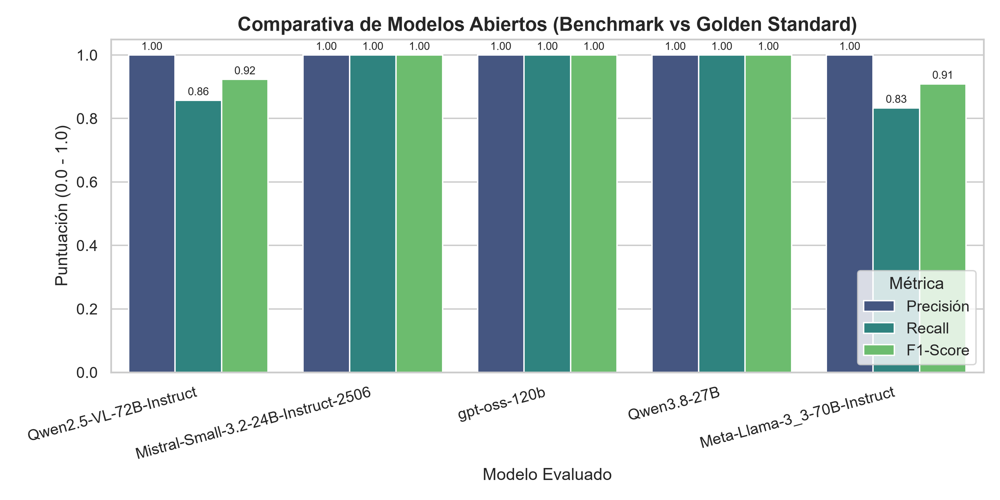

# Analizador del protagonismo de las mujeres en la prensa

Proyecto desarrollado en el marco del Reto **"Mujeres por la IA Abierta"** (noviembre de 2026), organizado por la Secretaría de Estado de Digitalización e Inteligencia Artificial (SEDIA) en colaboración con el COEINF (donesCOEINF), el centro IDEAI-UPC y OVHcloud.


---

## 1. Descripción

### Problema

Las mujeres tienen una presencia y un protagonismo desiguales en los medios de comunicación: aparecen menos, con menos frecuencia en titulares y, cuando aparecen, a menudo en roles secundarios o como víctimas o acompañantes, y con menos voz propia. Medir este sesgo a mano es lento y difícil de escalar.

### Caso de uso

Una herramienta que analiza automáticamente artículos de prensa y calcula indicadores de protagonismo femenino, útil para observatorios de igualdad, redacciones, investigadoras e investigadores en comunicación y administraciones públicas.

Para cada artículo, el programa extrae:

- Las personas individuales mencionadas, separadas en mujeres y hombres. Se ignoran cifras colectivas y grupos indeterminados ("10 millones de personas", "los ciudadanos").
- Si hay alguna mujer en el titular o en la apertura.
- El rol de cada mujer: `lider_o_experta`, `secundario` o `acompanante_o_victima`.
- Si cada mujer tiene cita directa (voz propia).

### Modalidad

**Texto.** El sistema procesa artículos de prensa en formato texto (titular y cuerpo).

### Metodología

1. **Dataset:** [`projecte-aina/caBreu`](https://huggingface.co/datasets/projecte-aina/caBreu). Se ha trabajado con una muestra de 250 artículos.
2. **Golden standard:** de esa muestra, 15 artículos anotados manualmente por el equipo (`data/golden_standard.json`).
3. **Benchmark:** se comparan 5 modelos abiertos, accedidos mediante OVHcloud AI Endpoints, frente al golden standard (precisión, recall y F1 en la detección de mujeres, y exactitud en la presencia en titular o apertura).
4. **Análisis final:** el mejor modelo se usa para procesar los 250 artículos.

### Estructura del proyecto

```
reto-ia-mujeres-equipo7/
├── data/
│   ├── dataset_15.json
│   ├── dataset_250_articulos.json
│   └── golden_standard.json
├── results/
│   ├── gpt-oss-120b/
│   ├── Meta-Llama-3_3-70B-Instruct/
│   ├── Mistral-Small-3.2-24B-Instruct-2506/
│   ├── Qwen2.5-VL-72B-Instruct/
│   ├── Qwen3.8-27B/
│   ├── benchmark_global_modelos.png
│   └── comparativa_modelos.csv
├── src/
│   ├── calcular_metricas.py
│   ├── evaluacion_modelos.py
│   └── visualizacion.py
├── .gitignore
├── LICENSE
├── main.py
├── README.md
└── requirements.txt
```

---

## 2. Instrucciones de instalación

**Requisitos previos:** Python 3.10 o superior, Git y una clave de API de OVHcloud AI Endpoints.

**Paso 1. Clonar el repositorio**

```bash
git clone <URL_DEL_REPOSITORIO>
cd reto-ia-mujeres-equipo7
```

**Paso 2. Crear y activar un entorno virtual**

```bash
python -m venv .venv
source .venv/bin/activate        # Linux / macOS
.venv\Scripts\activate           # Windows
```

**Paso 3. Instalar las dependencias**

```bash
pip install -r requirements.txt
```

El archivo `requirements.txt` fija las versiones exactas con las que se ha desarrollado y probado el proyecto. Las dependencias directas son `openai`, `python-dotenv`, `pandas`, `matplotlib` y `seaborn`; el resto son dependencias que se instalan con ellas (por ejemplo `numpy`, `pydantic` o `httpx2`).

**Paso 4. Configurar las variables de entorno**

Crea un archivo `.env` en la raíz del proyecto:

```env
OVH_API_KEY= "tu_token_de_ovhcloud"
OVH_API_BASE= "https://oai.endpoints.kepler.ai.cloud.ovh.net/v1"
MODEL_NAME= "nombre_del modelo"
INPUT_DATA_PATH= "data/dataset_elegido.json"
GOLDEN_STANDARD_PATH= "data/golden_standard.json"
RESULTS_DIR= "results"
```
Ejemplo de archivo `.env`
```env
OVH_API_KEY= "tu_token_de_ovhcloud"
OVH_API_BASE= "https://oai.endpoints.kepler.ai.cloud.ovh.net/v1"
MODEL_NAME= "Meta-Llama-3_3-70B-Instruct"
INPUT_DATA_PATH= "data/dataset_15.json"
GOLDEN_STANDARD_PATH= "data/golden_standard.json"
RESULTS_DIR= "results"
```


| Variable  | Descripción |
|---|---|
| `OVH_API_KEY` | Token de OVHcloud AI Endpoints |
| `MODEL_NAME` | Modelo a utilizar |
| `OVH_API_BASE`  | URL base de la API |
| `INPUT_DATA_PATH`  | Dataset de entrada (por defecto `data/dataset_15.json`) |
| `GOLDEN_STANDARD_PATH`  | Anotación manual (por defecto `data/golden_standard.json`) |
| `RESULTS_DIR` | Carpeta de resultados (por defecto `results`) |


---

## 3. Guía de uso

### Ejecutar el pipeline completo con los datos de prueba

Con los 15 artículos de `data/dataset_15.json` y el modelo configurado en `.env`:

```bash
python main.py
```

Esto ejecuta tres pasos: inferencia con el modelo, cálculo de métricas frente al golden standard y generación de gráficas. Los resultados quedan en `results/<nombre_del_modelo>/`.

### Ejecutar cada paso por separado

```bash
python -m src.evaluacion_modelos   # Inferencia: genera predicciones.json y predicciones.csv
python -m src.calcular_metricas    # Métricas: genera metricas.json y comparativa_modelos.csv
python -m src.visualizacion        # Gráficas: genera los .png
```

### Comparar los cinco modelos

Cambia `MODEL_NAME` en el `.env` y vuelve a ejecutar `python main.py`. Cada modelo guarda sus resultados en su carpeta, y `results/comparativa_modelos.csv` se actualiza con una fila por modelo.

```bash
MODEL_NAME= "Meta-Llama-3_3-70B-Instruct python main.py"
MODEL_NAME= "gpt-oss-120b python main.py"
```

### Analizar el dataset completo (250 artículos)

```bash
INPUT_DATA_PATH=data/dataset_250.json MODEL_NAME=<modelo_elegido> python main.py
```

Las métricas frente al golden standard solo se calculan para los artículos presentes en ambos ficheros.

### Resultados del benchmark

Evaluación de los 5 modelos frente al golden standard (15 artículos, 18 mujeres anotadas manualmente):

| Modelo | Precisión | Recall | F1 | TP | FP | FN |
|---|---|---|---|---|---|---|
| Mistral-Small-3.2-24B-Instruct-2506 | 0.9444 | 0.9444 | 0.9444 | 17 | 1 | 1 |
| Qwen3.8-27B | 1.0000 | 0.8889 | 0.9412 | 16 | 0 | 2 |
| gpt-oss-120b | 0.9412 | 0.8889 | 0.9143 | 16 | 1 | 2 |
| Meta-Llama-3_3-70B-Instruct | 1.0000 | 0.8333 | 0.9091 | 15 | 0 | 3 |
| Qwen2.5-VL-72B-Instruct | 1.0000 | 0.7778 | 0.8750 | 14 | 0 | 4 |

**TP:** mujeres detectadas correctamente. **FP:** personas detectadas como mujeres que no lo son. **FN:** mujeres que el modelo no detecta.

En los cinco modelos, la exactitud en la detección de mujer en titular o apertura es 1.00.



**Cómo leer la gráfica:** cada grupo de barras es un modelo y cada barra una métrica, con una puntuación de 0 a 1 (cuanto más alta, mejor).

- **Precisión:** de las mujeres que detecta el modelo, cuántas son correctas. Una precisión baja indica falsos positivos.
- **Recall:** de las mujeres que hay en el texto, cuántas detecta el modelo. Un recall bajo indica que se le escapan mujeres.
- **F1-Score:** media armónica de precisión y recall; resume el equilibrio entre ambas.

**Conclusiones:**

- **Mistral-Small** obtiene el mejor F1 (0.9444) y el mejor recall (0.9444): detecta 17 de las 18 mujeres, con un solo falso positivo.
- **Qwen3.8-27B** queda muy cerca (F1 0.9412). No tiene falsos positivos, pero se le escapan 2 mujeres. La diferencia con Mistral-Small equivale a una sola mujer.
- Los modelos con precisión 1.00 (Qwen3.8-27B, Llama 3.3 y Qwen2.5-VL) son más conservadores: no se inventan mujeres, pero omiten más.
- El modelo más grande (gpt-oss-120b, 120B parámetros) no obtiene mejores resultados que modelos mucho más pequeños.

### Modelo seleccionado: Mistral-Small-3.2-24B-Instruct-2506

Elegimos Mistral-Small por:

- **Mejor rendimiento:** F1 más alto (0.9444) y mejor recall, lo que importa especialmente para medir presencia femenina, donde omitir mujeres distorsiona el resultado.
- **Eficiencia:** con 24B de parámetros, es el modelo más pequeño de los evaluados, lo que reduce el coste, el tiempo y el consumo al procesar los 250 artículos.
- **Licencia abierta:** Apache 2.0, sin restricciones adicionales.
- **Origen europeo:** modelo europeo servido desde infraestructura europea (OVHcloud).

> **Limitación:** el golden standard tiene solo 15 artículos y 18 mujeres, por lo que una diferencia de una mujer cambia el ranking. Las diferencias entre los dos primeros modelos son pequeñas y deben interpretarse con cautela. Además, la exactitud de titular/apertura no distingue entre modelos, porque en el golden standard ningún artículo tiene mujer en el titular o la apertura.
---

## 4. Componentes de terceros

### Modelos base (OVHcloud AI Endpoints)

| Modelo | Licencia |
|---|---|
| Qwen2.5-VL-72B-Instruct | Qwen License (no es Apache 2.0; revisar condiciones de uso) |
| Meta-Llama-3_3-70B-Instruct | Llama 3.3 Community License |
| Mistral-Small-3.2-24B-Instruct-2506 | Apache 2.0 |
| gpt-oss-120b | Apache 2.0 |
| Qwen3.8-27B | _Verificar en la ficha del modelo_ |

### Dataset

| Recurso | Licencia |
|---|---|
| [projecte-aina/caBreu](https://huggingface.co/datasets/projecte-aina/caBreu) | _CC BY-NC-ND 4.0_ |

### Dependencias de Python

| Paquete | Uso | Licencia |
|---|---|---|
| [openai](https://github.com/openai/openai-python) | Cliente compatible con la API de OVHcloud | Apache 2.0 |
| [python-dotenv](https://github.com/theskumar/python-dotenv) | Carga de variables de entorno | BSD-3-Clause |
| [pandas](https://pandas.pydata.org/) | Tratamiento de datos y CSV | BSD-3-Clause |
| [matplotlib](https://matplotlib.org/) | Gráficas | Licencia Matplotlib (basada en PSF, permisiva) |
| [seaborn](https://seaborn.pydata.org/) | Gráficas estadísticas | BSD-3-Clause |

### Infraestructura

- **OVHcloud AI Endpoints:** inferencia de los modelos mediante API compatible con OpenAI.

---
## 5. Hoja de ruta (Roadmap)

**Fase 1: Benchmark inicial (completada)**
- [x] Anotación manual de un golden standard de 15 artículos de caBreu.
- [x] Pipeline completo: extracción con LLM, cálculo de métricas y visualización.
- [x] Comparación de 5 modelos abiertos frente al golden standard.

**Fase 2: Análisis a escala (en curso)**
- [x] Seleccionar el mejor modelo según el benchmark.
- [x] Procesar los 250 artículos con el modelo seleccionado.
- [x] Obtener los indicadores globales de presencia y protagonismo femenino.

**Fase 3: Mejoras futuras**
- [ ] **Análisis por categoría:** cruzar los resultados con la categoría de cada artículo (política, economía, cultura, sociedad…) para ver en qué ámbitos tienen más o menos presencia las mujeres. Requiere unificar las categorías de caBreu, ya que algunos artículos no tienen y el formato varía.
- [ ] **Más modelos:** ampliar el benchmark con otros modelos abiertos disponibles.
- [ ] **Modelos grandes frente a pequeños:** comparar modelos con muchos parámetros (70B-120B) con otros mucho más pequeños, para ver cuánta calidad se pierde y cuánto se ahorra en coste y consumo.
- [ ] **Golden standard más grande y más difícil:** pasar de 15 a más artículos anotados a mano, incluyendo textos ambiguos (nombres que no indican género claro, referencias por cargo, nombres incompletos, etc.) para que el benchmark distinga mejor entre modelos.
---

## Equipo

 Sofia Mirza Chowdhury, Laura Lope Izquierdo, Sofia Boyko Boyko

## Licencia del proyecto

 Este proyecto está distribuido bajo la licencia de código abierto **MIT**. Para más detalles, consulta el archivo [LICENSE](LICENSE).

## Agradecimientos

SEDIA, COEINF (donesCOEINF), IDEAI-UPC y OVHcloud, por el reto y el acceso a los modelos. Al proyecto AINA por el dataset caBreu.